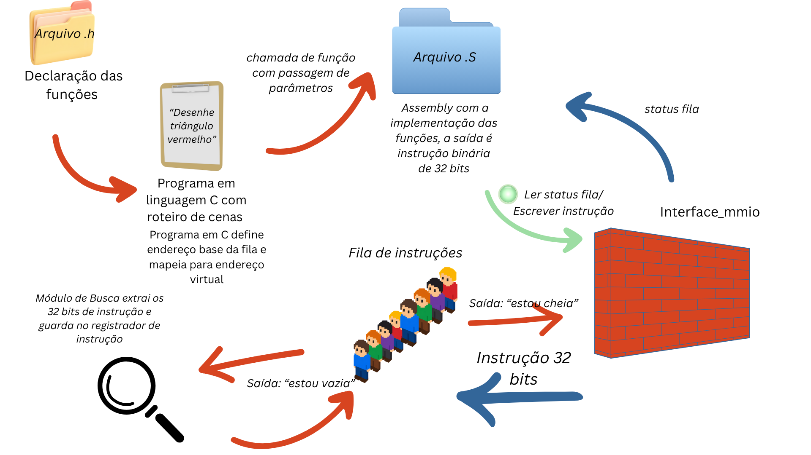

# Coprocessador Gráfico Programável em FPGA
### MI de Sistemas Digitais (TEC499) - TP03

---

## Introdução

Os sistemas computacionais exigem, de forma recorrente, a exibição de interfaces visuais complexas, o que demanda a atualização constante de uma vasta matriz de pixels para a formação de quadros na tela. Em um cenário onde a CPU (Central Processing Unit) precisa controlar individualmente cada módulo gráfico, o software passa a conhecer detalhes internos do hardware, o que aumenta a complexidade da aplicação e sobrecarrega o processador principal. Diante disso, surge a necessidade de um coprocessador gráfico programável, capaz de interpretar comandos de alto nível e acionar, por conta própria, os recursos necessários para a geração das imagens.

Diante dessa abordagem, foi solicitado aos alunos da disciplina TEC499 (Sistemas Digitais) da Universidade Estadual de Feira de Santana a evolução do núcleo gráfico desenvolvido no Problema 1 para um coprocessador gráfico programável em FPGA, inspirado na arquitetura de consoles de 16 bits. O novo sistema adota uma organização semelhante à de processadores convencionais, contando com uma ISA (Instruction Set Architecture) de 32 bits, unidade de busca de instruções, registrador de instrução, unidade de controle, banco de registradores, ULA, datapath e registrador de status. Os motores de background, sprites e rasterização de polígonos passam a atuar como unidades funcionais, cujas operações ocorrem como consequência da execução de instruções. O projeto utiliza a placa DE1-SoC e a linguagem de descrição de hardware Verilog, sendo preparado para, em etapas posteriores, ser controlado por um driver Linux em Assembly ARM para a execução de uma aplicação de jogo em C.

## Pré-requisitos

É necessário ter um kit de desenvolvimento DE1-SoC, pertencente à família Cyclone V. Também é necessário possuir o software Quartus Prime Lite Edition (a versão 23.1 foi utilizada no desenvolvimento) instalado no dispositivo para implementar o coprocessador na placa e realizar a síntese do hardware. Além disso, o uso de um monitor com interface VGA é essencial para a visualização das imagens geradas e dos resultados obtidos.

Os requisitos de hardware devem ser estritamente seguidos, visto que a pinagem e a configuração dos clocks estão estabelecidas para o kit de desenvolvimento especificado.

## Como instalar?

O projeto tem duas partes: o **hardware** (síntese e gravação na FPGA pelo Quartus) e o **software** (driver em Assembly ARM e programas em C, compilados e executados no Linux embarcado da DE1-SoC).

### 1. Gravação do hardware na FPGA

1. Faça o download do projeto como arquivo .zip do repositório e extraia no seu computador.
2. Abra o software Quartus Prime.
3. Acesse File > Open Project.
4. Encontre e selecione o arquivo `soc_system.qpf` na pasta raiz extraída.
5. Com o projeto aberto, inicie a compilação clicando no ícone de compilação ou acessando Processing > Start Compilation.
6. Vá em Tools > Programmer.
7. Clique em Hardware Setup para garantir que o Quartus reconheceu a placa conectada.
8. Carregue o arquivo .sof gerado e clique em Start para gravar o hardware na FPGA.
9. Conecte o monitor à saída VGA da placa. A cena será exibida a partir da execução dos programas do passo 2.

### 2. Execução do driver e dos programas no Linux da placa

Os arquivos do driver ficam na pasta `Driver/`:

| Arquivo | Descrição |
|---|---|
| `gpu_driver.S` | Driver em Assembly ARM. Monta as instruções da ISA e as envia à fila (FIFO) via MMIO |
| `gpu_isa.h` | Cabeçalho em C com os protótipos das funções `asm_*` do driver |
| `teste.c` | Programa com menu interativo (uma opção por instrução da ISA) e cenas animadas |
| `teste2.c` | Cenas criativas de demonstração |
| `teste3.c` | Bateria de testes passo a passo das instruções, incluindo `BG_TILE` e `BG_MOVER` |

**Passo a passo:**

1. Com o hardware já gravado na FPGA, conecte seu computador à rede da placa e acesse-a por SSH, usando o IP impresso na placa:
```bash
   ssh aluno@<IP_DA_PLACA>
```
2. No seu computador, copie a pasta `Driver` para a placa com `scp`:
```bash
   scp -r Driver aluno@<IP_DA_PLACA>:/home/aluno/
```
3. Na placa, entre na pasta:
```bash
   cd ~/Driver
```
4. Compile o programa desejado junto com o driver em Assembly, usando o `gcc`:
```bash
   gcc -std=gnu99 teste.c gpu_driver.S -o programa_gpu -lm
```
   Para os demais programas, troque o arquivo `.c` e o nome do executável:
```bash
   gcc -std=gnu99 teste2.c gpu_driver.S -o programa_gpu2 -lm
   gcc -std=gnu99 teste3.c gpu_driver.S -o teste3 -lm
```

5. Execute o programa. O acesso à memória física (`/dev/mem`) exige privilégios de administrador:
```bash
   sudo ./programa_gpu
```
6. Acompanhe a saída no monitor VGA. Nos programas com animação, use `Ctrl+C` para voltar ao menu ou encerrar.

> **Observação:** a pasta `Driver/` já contém executáveis ARM pré-compilados (`programa_gpu`, `programa_gpu2`, `teste3` e `trio`). Eles podem ser executados diretamente na placa com `sudo ./<nome>`, sem recompilar.

## Requisitos do problema

O problema exige a evolução do núcleo gráfico desenvolvido anteriormente para um coprocessador gráfico programável, no qual a aplicação não precisa conhecer os detalhes internos de cada módulo e apenas envia comandos, cabendo ao hardware interpretá-los e acionar os recursos necessários. Os requisitos estipulados foram:

### Requisitos funcionais

* Hardware do coprocessador descrito em Verilog e implementado na placa DE1-SoC.
* ISA (Instruction Set Architecture) de 32 bits, com formatos de instrução, codificação e decodificação documentados pela equipe.
* Arquitetura baseada em Datapath e Unidade de Controle, implementando o ciclo de busca/execução de instruções e contendo, no mínimo:
   * Unidade de busca de instruções;
   * Registrador de Instrução (IR);
   * Unidade de Controle;
   * Banco de registradores;
   * Unidade Lógica e Aritmética (ULA);
   * Registrador de status;
   * Datapath.
* Obtenção das instruções por **busca passiva**, a partir de uma fila de comandos (FIFO) alimentada pelo processador ARM por meio da interface MMIO.
* Programa em Assembly ARM (driver) que monte as instruções da ISA e as envie à fila de comandos, respeitando o controle de fila cheia.
* Biblioteca em C (`gpu_isa.h`) que exponha as instruções do coprocessador para as aplicações, sem que estas conheçam os detalhes internos de cada módulo gráfico.
* Execução de toda operação gráfica como consequência de uma instrução pertencente à ISA definida.
* Comunicação entre o controle e as unidades funcionais por meio de sinais do tipo `valid`, `busy` e `done`.
* Mecanismo de sincronização com o VGA.
* Programa de demonstração escrito em Assembly da ISA criada pela equipe, com sintaxe própria definida pelo grupo.
* Programas de teste em C, compilados com `gcc` e executados no terminal do Linux embarcado da placa, que exercitem todas as instruções da ISA.

## Recursos utilizados

* **Placa DE1-SoC:** Hardware principal. O chip FPGA (família Cyclone V) recebe a descrição do projeto e instancia os blocos de memória. O HPS (Hard Processor System) da mesma placa, com processador ARM Cortex-A9 executando Linux embarcado, é usado para rodar o driver e os programas de teste.
* **Quartus Prime Lite 23.1:** Software que permite a criação, depuração e otimização de códigos em linguagem de descrição de hardware. Foi utilizado para gerar os IP Cores (circuitos lógicos pré-projetados) necessários (ALTSYNCRAM para memórias dedicadas e Altera PLL para geração de clock específico) e para sintetizar e gravar o projeto (`.sof`) na FPGA.
* **Visual Studio Code (versão atualizada):** Editor de código utilizado no desenvolvimento dos programas em linguagem C (`.c`), do cabeçalho (`.h`) e do driver em Assembly ARM (`.S`).
* **GCC (GNU Compiler Collection):** Compilador executado diretamente no Linux da DE1-SoC, utilizado para compilar os programas em C junto com o driver em Assembly ARM.
* **SSH e SCP:** Ferramentas utilizadas para acessar o terminal da placa pela rede e transferir os arquivos do driver e dos programas de teste do computador para a DE1-SoC.
* **GitHub:** Plataforma de hospedagem utilizada para versionar os arquivos de código-fonte (`.v`, `.c`, `.h`, `.S`), projetos (`.qpf`, `.qsf`) e arquivos de inicialização de memória (`.mif`, `.hex`).

## Metodologia

Os computadores possuem como um dos seus componentes principais o processador (CPU), que realiza o controle do fluxo de dados e o processamento de instruções do sistema. Contudo, muitas operações, como o cálculo contínuo das coordenadas de pixels, exigem muito poder de processamento, o que pode sobrecarregar a CPU e tornar o sistema lento. Assim, surge a ideia do coprocessador gráfico (GPU), uma unidade de processamento auxiliar que atua de forma independente e paralela à CPU, servindo para realizar as operações de geração de imagem de forma muito mais eficiente.

Para o desenvolvimento deste coprocessador, a arquitetura foi planejada com foco no paralelismo de hardware e na programabilidade. A CPU (ARM do HPS) não conhece os detalhes internos dos módulos gráficos: ela apenas envia instruções de 32 bits, definidas pela ISA do projeto. Cabe ao hardware buscar, decodificar e executar cada instrução, acionando o motor gráfico correspondente. A geração de imagens exige um sincronismo rigoroso com o monitor VGA. Por isso, o sistema opera com dois domínios de clock: um clock de 50 MHz para a fila de instruções, a unidade de controle, os motores gráficos e a escrita na memória de vídeo, e um clock de 25 MHz para a leitura contínua da memória de vídeo e o envio do sinal VGA.

Esta seção acompanha o caminho percorrido por uma instrução, do software até a imagem exibida no monitor, e está organizada na seguinte ordem: (1) **Instruções**, com o formato e o conjunto de instruções da ISA; (2) **Caminho da Instrução até a Fila**, que descreve o trajeto do programa em C até a entrada da fila, passando pelo driver em Assembly ARM e pela interface MMIO; (3) **Fila de Instruções**, que armazena os comandos enviados pelo processador; (4) **Unidade de Busca**, que retira as instruções da fila e as entrega ao registrador de instrução; (5) **Unidade de Controle**, que decodifica as instruções e coordena a execução; (6) **Motores gráficos**, que executam as operações de plano de fundo, sprites e polígonos e compõem a imagem final; (7) **Simulação**, com os testes e a validação do projeto; e (8) **Referências**, com as fontes consultadas.


### 1. ISA e interface de software

A arquitetura utiliza uma *Instruction Set Architecture* (ISA) de 32 bits para controlar as operações gráficas do coprocessador. Cada instrução possui um código de operação (*opcode*) nos bits `[31:27]`, enquanto os 27 bits restantes contêm os parâmetros específicos de cada comando. Foram definidas nove instruções, responsáveis pela configuração e movimentação de elementos gráficos, manipulação da paleta e sincronização com a VGA.

| Instrução | Opcode | Finalidade |
|---|---|---|
| `LOAD_REG` | `00000` | Armazenar um valor em um registrador do coprocessador. |
| `ESPERA_VSYNC` | `00001` | Aguardar a condição de sincronismo vertical implementada na Unidade de Controle. |
| `PALE_DEFINIR` | `00010` | Definir uma cor em uma posição da paleta. |
| `SPR_CRIAR` | `00011` | Configurar um sprite. |
| `SPR_MOVER` | `00100` | Movimentar um sprite em uma direção. |
| `BG_TILE` | `00101` | Selecionar um *tilemap* de plano de fundo. |
| `BG_MOVER` | `00110` | Movimentar o plano de fundo. |
| `POLI_DEFINIR` | `00111` | Configurar um polígono. |
| `POLI_MOVER` | `01000` | Movimentar um polígono em uma direção. |

A definição da ISA estabelece o formato binário dos comandos e permite que a Unidade de Controle identifique a operação solicitada a partir do *opcode*, interpretando os demais campos de acordo com o tipo de instrução.

#### 1.1. Arquivo `gpu_isa.h`

O arquivo `gpu_isa.h` declara as funções disponíveis para os programas em C. Seus protótipos definem os nomes, os tipos e a ordem dos argumentos esperados, permitindo que a aplicação utilize as instruções sem implementar diretamente a codificação binária.

Um exemplo é a declaração:

```c
void asm_load_reg(
    volatile uint32_t *mmio,
    uint32_t reg_dest,
    uint32_t valor
);
```

O ponteiro `mmio` identifica a região de endereços utilizada para acessar o coprocessador endereçado; `reg_dest` indica o registrador de destino do coprocessador; e `valor` corresponde ao dado a ser armazenado. O tipo `uint32_t` representa um inteiro sem sinal de 32 bits.

Esse arquivo .h não contém a implementação das instruções, pois é de responsabilidade do arquivo `gpu_driver.S`, definido em Assembly ARM que disponibiliza as funções declaradas para uso da aplicação.

#### 1.2. Programa em C

O programa em C define a sequência de comandos que compõe cada cena gráfica e fornece os parâmetros necessários às operações. As chamadas das funções declaradas em `gpu_isa.h` permitem configurar registradores, cores, sprites, plano de fundo e polígonos, além de solicitar a sincronização com a VGA.

Por exemplo:

```c
asm_load_reg(mmio, REG_XY, empacotar_xy(x, y));
asm_spr_criar(mmio, REG_XY, indice, textura, 1, 0, 0);
```

Nesse exemplo, a primeira chamada armazena as coordenadas empacotadas no registrador `REG_XY`. A segunda solicita a configuração de um sprite, utilizando esse registrador como fonte das coordenadas e fornecendo o índice, a textura, a visibilidade e as opções de espelhamento.

Dessa forma, o C define a operação desejada e seus parâmetros, enquanto o driver em Assembly ARM realiza a codificação e o envio das instruções ao hardware.

### 2. Caminho da instrução até a FIFO

O envio das instruções utiliza o mecanismo de entrada e saída mapeadas em memória (*Memory-Mapped Input/Output* — MMIO). Essa abordagem permite que o processador ARM acesse registradores do periférico por meio de operações de leitura e escrita em endereços de memória.

No programa em C, a região é acessada por meio de `open()` e `mmap()`. A constante `MMIO_BASE`, definida como `0xFF200000`, representa o endereço físico utilizado pelo programa, que deve corresponder ao mapeamento configurado para o periférico no *Platform Designer*. O resultado de `mmap()` é convertido em um ponteiro `volatile uint32_t *`, utilizado nas chamadas do driver para acessar a região mapeada.

#### 2.1. Codificação em Assembly ARM

O arquivo `gpu_driver.S` implementa as funções declaradas em `gpu_isa.h`. Cada função recebe os argumentos da operação, utiliza instruções ARM para posicionar os campos definidos pela ISA e monta a palavra binária de 32 bits correspondente ao comando.

Operações como `AND`, `LSL` e `ORR` são utilizadas para coletar, deslocar e combinar os campos da instrução. Ao final da montagem, a palavra completa fica disponível no registrador `R1` para ser enviada ao periférico. O registrador `R0` mantém o ponteiro `mmio`.

O envio da instrução binária final é feita no label `_send_fifo`, compartilhada pelas funções do driver:

```asm
_send_fifo:
1:
    LDR R2, [R0, #4]
    AND R2, R2, #1
    CMP R2, #1
    NOP
    BEQ 1b

    STR R1, [R0, #0]
    BX LR
```

Essa função consulta inicialmente o registrador de estado, acessado pelo deslocamento de quatro bytes em relação à base. A operação `AND` isola o bit menos significativo, que representa o indicador de fila cheia. Se o resultado for `1`, a instrução `BEQ 1b` retorna ao início do laço, repetindo a consulta. Quando a fila não está cheia, `STR R1, [R0, #0]` escreve a palavra de 32 bits no registrador destinado ao recebimento das instruções, e `BX LR` retorna à função que realizou a chamada.

Esse procedimento implementa uma espera ocupada (*busy-waiting*), ou seja, o ARM aguarda a disponibilidade de espaço antes de realizar a escrita, evitando enviar novos comandos quando a fila está cheia.

#### 2.2. Fluxo da instrução

O fluxo completo, desde a chamada da função em C até o armazenamento da instrução na FIFO, é apresentado na Figura 1.



*Figura 1 — Caminho da instrução desde a aplicação em C até a fila do coprocessador.*

O fluxograma representa a participação do programa em C, do driver em Assembly ARM, da interface MMIO e da fila de instruções. Após o envio, a instrução permanece armazenada até ser solicitada pela Unidade de Busca, que a encaminha para o registrador de instrução e, posteriormente, para a Unidade de Controle.

### 3. Interface MMIO e fila de instruções

A comunicação entre o processador ARM e a fila exigiu uma interface dedicada porque as operações realizadas pelo barramento Avalon-MM não correspondem diretamente aos sinais necessários para controlar a FIFO. O barramento transporta endereço, dados e sinais de leitura ou escrita; a fila, por sua vez, necessita de um sinal de escrita, de uma palavra de 32 bits e de um sinal de leitura. A `interface_mmio` realiza essa adaptação, decodificando os acessos do ARM e convertendo-os em sinais utilizados pela fila.

#### 3.1. Módulo `interface_mmio`

A interface recebe os sinais do barramento, identifica o registrador acessado e encaminha as informações de acordo com a operação solicitada. No projeto, foram definidos dois endereços locais para a comunicação:

| Endereço local | Deslocamento utilizado | Operação | Finalidade |
|---|---|---|---|
| `00` | `0x00` | Escrita | Receber a instrução de 32 bits. |
| `01` | `0x04` | Leitura | Retornar o indicador de fila cheia. |

Essa correspondência deve ser compatível com a configuração de endereçamento da interface no *Platform Designer*.

Na operação de escrita, o módulo verifica se `avs_escrever` está ativo, se estava inativo no ciclo anterior e se `avs_endereco` corresponde a `00`. Quando as condições são satisfeitas, a instrução presente em `avs_instrucao` é armazenada em `coe_fila_instrucao`, e o sinal `coe_fila_escrever` é ativado por um ciclo de clock. O registrador `avs_escrever_anterior` permite identificar a nova borda de subida do sinal de escrita.

Na operação de leitura, quando `avs_ler` está ativo e o endereço local corresponde a `01`, a interface retorna o estado de `coe_fila_cheia` no bit menos significativo de `avs_SinalFila`, mantendo os outros bits em zero. Essa informação é utilizada pelo driver em Assembly ARM para determinar quando pode enviar uma nova instrução.

Portanto, a interface não realiza a interpretação do comando gráfico nem armazena uma sequência de instruções. Sua função é transformar as operações de acesso ao periférico do coprocessador em sinais adequados à comunicação com a FIFO e disponibilizar o estado da fila ao ARM.

#### 3.2. Módulo `fila_fifo`

A FIFO (*First-In, First-Out*) armazena temporariamente as instruções recebidas do ARM, mantendo a ordem de chegada dos comandos até que sejam consumidos pela Unidade de Busca. Sua capacidade padrão é de 16 posições, cada uma com largura de 32 bits.

O armazenamento é implementado por um vetor `fila`, enquanto os registradores `ponteiro_escrever` e `ponteiro_ler` controlam as posições de entrada e saída. Ambos possuem quatro bits, permitindo endereçar as posições de 0 a 15. Ao avançarem além da última posição, retornam naturalmente a zero, formando uma estrutura circular. O registrador `quantidade`, de cinco bits, contabiliza os elementos armazenados e permite identificar os estados de fila cheia e vazia.

A escrita ocorre quando `fila_escrever` está ativo e `fila_cheia` está inativo. A instrução fornecida em `arm_instrucao` é armazenada na posição indicada por `ponteiro_escrever`, que avança após a operação. A leitura ocorre quando `unidade_ler` está ativo e `fila_vazia` está inativo. Nesse caso, o ponteiro de leitura avança para a próxima posição.

A saída `instrucao_saida` é combinacional e acompanha diretamente a posição indicada por `ponteiro_ler`. Dessa forma, a instrução localizada no começo da fila já está disponível na saída, sem depender de uma operação de leitura para que seu valor seja apresentado.

Os sinais `fila_cheia` e `fila_vazia` são derivados de `quantidade`: a fila está cheia quando contém 16 instruções e vazia quando não contém nenhuma. Em condições normais, se uma leitura e uma escrita forem solicitadas simultaneamente, com a fila nem cheia nem vazia, os dois ponteiros avançam e a quantidade permanece constante, pois uma instrução entra enquanto outra é lida.

A escrita é controlada pela interface MMIO, enquanto a leitura é solicitada pela Unidade de Busca por meio de `valid_leitura_fifo`, conectado ao sinal `unidade_ler` da fila. Essa separação permite que o ARM envie comandos sem controlar diretamente o instante em que o coprocessador os processa.

#### 3.3. Integração da comunicação

A integração entre o driver, a interface MMIO e a FIFO estabelece o caminho de transferência das instruções entre o processador ARM e o coprocessador gráfico. O driver verifica o estado da fila antes de escrever, a interface converte a operação de barramento em um pulso de escrita e a FIFO armazena a palavra recebida. No sentido da leitura, a Unidade de Busca solicita a instrução disponível e a FIFO avança seu ponteiro, disponibilizando o próximo comando.

Essa organização separa as responsabilidades do software, da interface de comunicação e do armazenamento temporário. Assim, o programa em C não precisa conhecer os ponteiros ou a estrutura interna da fila, enquanto a Unidade de Busca obtém as instruções na ordem em que foram enviadas. A instrução disponibilizada é armazenada no registrador de instrução e entregue à Unidade de Controle para decodificação e execução da operação correspondente.

### 4. Unidade de Busca

A unidade de busca é responsável por trazer, uma a uma, as instruções armazenadas na fila para dentro do coprocessador. O módulo `unidade_de_busca.v` implementa a estratégia de **busca passiva**: em vez de varrer uma memória de programa interna com um contador de programa (PC), ele consome as instruções que o processador ARM enfileirou por meio da interface MMIO. Dessa forma, o programa gráfico não fica gravado na FPGA, e o ARM pode alterá-lo a qualquer momento apenas enviando novas instruções à fila.

O módulo se comunica com a fila por três sinais. A entrada `dado_fifo` recebe a instrução de 32 bits que está na cabeça da fila, a entrada `fifo_vazia` informa se há instruções disponíveis e a saída `valid_leitura_fifo` pede à fila que descarte a instrução lida, avançando seu ponteiro de leitura. Como a fila trabalha no modo *first-word fall-through*, o dado já está visível em `dado_fifo` antes de qualquer pedido de leitura. A unidade pode, assim, capturar a instrução e só depois avisar a fila de que ela foi consumida. Com a unidade de controle, a comunicação é feita pelo sinal de entrada `valid_busca`, que autoriza uma nova busca, e pelo sinal de saída `instrucao_valida`, que avisa que a instrução capturada, disponível na saída `instrucao`, já pode ser usada. Todo o módulo opera no mesmo clock de 50 MHz da fila e da unidade de controle, o que dispensa circuitos de sincronização entre domínios de clock.

O funcionamento é descrito por uma Máquina de Estados Finitos (MEF) de três estados:

* **PARADO:** estado inicial, em que a unidade aguarda. Quando a unidade de controle autoriza a busca (`valid_busca` em nível alto) e a fila possui ao menos uma instrução (`fifo_vazia` em nível baixo), a máquina avança para o estado de leitura.
* **LEITURA:** a unidade emite o pedido de leitura para a fila (`valid_leitura_fifo`) e avança para o estado seguinte. Por ser um sinal registrado, o pedido chega à fila durante o estado VÁLIDO, quando a instrução ainda está na cabeça da fila.
* **VÁLIDO:** a unidade captura o conteúdo de `dado_fifo` no registrador `instrucao`, sinaliza `instrucao_valida` e retorna ao estado PARADO. Nesse mesmo ciclo, a fila atende ao pedido de leitura e avança para a próxima instrução.

Os sinais `valid_leitura_fifo` e `instrucao_valida` são pulsos de um único ciclo de clock: a cada ciclo, eles retornam ao nível baixo por padrão e só são elevados nos estados descritos. Esse formato de pulso é o mesmo adotado nos sinais `valid` entre a unidade de controle e os motores gráficos, o que mantém o protocolo de comunicação uniforme em todo o projeto. Uma busca completa leva quatro ciclos de clock, ou 80 ns a 50 MHz, um tempo desprezível diante da duração da execução das instruções pelos motores gráficos. A unidade de controle mantém `valid_busca` em nível alto apenas enquanto aguarda uma nova instrução (estado MONITORAR).

Ao receber o pulso `instrucao_valida`, o Registrador de Instrução (`registrador_de_instrucao.v`) armazena a instrução em `IR`, mantendo-a estável para que a unidade de controle decodifique o opcode e distribua os campos aos motores gráficos. Um sinal de reset zera a máquina de estados e todas as saídas, de modo que o coprocessador sempre inicie sem buscas pendentes.

### 5. Unidade de Controle

A Unidade de Controle (UC) é responsável por coordenar a execução das instruções do coprocessador gráfico. Após a Unidade de Busca disponibilizar uma nova instrução no Registrador de Instrução (`IR`), cabe à UC interpretar seus campos, selecionar os recursos necessários e controlar a execução da operação correspondente.

O módulo `Unidade_Controle`, desenvolvido em Verilog, realiza a comunicação entre o Registrador de Instrução, o Banco de Registradores e as unidades funcionais do sistema: motor de sprites, motor de background, rasterizador e paleta de cores.

A implementação foi organizada em duas partes principais: uma lógica combinacional, responsável pela decodificação e distribuição dos parâmetros, e uma lógica sequencial, responsável pelo controle do fluxo de execução.

#### 5.1. Decodificação e distribuição dos parâmetros

A UC recebe a instrução pelo barramento `IR[31:0]` e utiliza o campo `IR[31:27]` para identificar a operação a ser executada.

A partir do opcode, a lógica combinacional seleciona os campos relevantes da instrução e os direciona às saídas correspondentes. Cada motor possui um conjunto próprio de sinais de dados, permitindo que a UC forneça os parâmetros necessários à operação solicitada.

No caso do motor de sprites, por exemplo, a UC disponibiliza informações como índice do sprite, posição, índice da textura, visibilidade, espelhamento e direção de movimento. Para o rasterizador, são fornecidos parâmetros como índice do polígono, coordenadas, dimensões, cor, tipo de figura e visibilidade.

Algumas instruções utilizam valores previamente armazenados no Banco de Registradores. Nessas situações, a UC também determina os endereços de leitura e utiliza os dados retornados para compor os parâmetros enviados aos motores.

Essa organização permite que a interpretação da instrução seja centralizada na UC, enquanto cada unidade funcional permanece responsável pela execução de sua operação específica.

Na implementação combinacional, as saídas recebem valores padrão antes da seleção dos campos de cada instrução. Essa prática evita a inferência de *latches* indesejados durante a síntese do circuito.

#### 5.2. Máquina de Estados Finitos

O sequenciamento das instruções é realizado por uma Máquina de Estados Finitos (MEF), implementada em lógica sequencial sincronizada pela borda de subida do clock.

A máquina possui dois estados principais:

- **MONITORAR:** estado em que a UC solicita uma nova instrução por meio do sinal `valid_busca`. Enquanto não recebe `instrucao_valida`, permanece aguardando. Quando a Unidade de Busca confirma a disponibilidade de uma instrução, a UC avança para `EXECUTAR`.
- **EXECUTAR:** estado responsável pelo acionamento da operação identificada. Dependendo do opcode, a UC realiza uma escrita no Banco de Registradores, aguarda o sincronismo vertical ou envia um comando a uma das unidades funcionais.

Para as operações gráficas, a UC utiliza dois registradores internos de controle:

- `esperando_motor`: indica que uma operação foi enviada e ainda aguarda confirmação de conclusão.
- `motor_esperado`: identifica qual unidade funcional foi acionada.

Ao executar uma instrução destinada a um motor gráfico, a UC ativa o sinal `valid` correspondente e registra qual motor deverá responder. Em seguida, permanece no estado `EXECUTAR` até receber o sinal `done` daquela unidade.

Após a confirmação, os registradores de acompanhamento são atualizados e a máquina retorna ao estado `MONITORAR`, permitindo que uma nova instrução seja buscada.

Esse mecanismo estabelece uma execução sequencial das instruções, impedindo que a UC inicie um novo comando enquanto ainda aguarda a conclusão da operação anterior.

Existem também operações que não dependem da confirmação de um motor:

- **`LOAD_REG`:** realiza a escrita de um valor no Banco de Registradores e retorna ao estado de monitoramento.
- **`ESPERA_VSYNC`:** mantém a UC no estado de execução até que o sinal `vsync` seja detectado.

Caso seja identificado um opcode não reconhecido, a máquina retorna ao estado `MONITORAR`, sem acionar os motores gráficos.

#### 5.3. Comunicação e sinais de controle

A comunicação entre a UC e os demais módulos é realizada por sinais de controle e barramentos de parâmetros.

| Interface | Sinais principais | Finalidade |
| --- | --- | --- |
| Unidade de Busca | `valid_busca`, `instrucao_valida` | Solicitar e receber a confirmação de uma nova instrução |
| Registrador de Instrução | `IR[31:0]` | Disponibilizar a instrução para decodificação |
| Banco de Registradores | `reg_write`, `reg_endereco_escrita`, `reg_dado_escrita`, endereços e dados de leitura | Realizar operações de escrita e leitura |
| Motor de Sprites | `valid_sprite`, `done_sprite` | Iniciar e confirmar operações com sprites |
| Motor de Background | `valid_background`, `done_background` | Iniciar e confirmar operações com cenários |
| Rasterizador | `valid_rasterizador`, `done_rasterizador` | Iniciar e confirmar operações com polígonos |
| Paleta | `valid_palette`, `done_palette` | Iniciar e confirmar atualizações da paleta |
| Sincronismo VGA | `vsync` | Controlar a execução da instrução de espera vertical |

Os sinais `valid` dos motores são gerados como pulsos de um ciclo de clock, indicando o início de uma operação. Os sinais `done` são recebidos pela UC e utilizados para determinar quando a execução pode prosseguir.

Os motores também possuem sinais `busy`, que indicam seu estado de ocupação. Embora esses sinais estejam presentes na interface da UC, a implementação atual utiliza os sinais `done` para confirmar o término das operações.

O módulo também possui uma entrada de reset, responsável por inicializar a máquina no estado `MONITORAR`, limpar os registradores internos de acompanhamento e desativar os sinais de controle.

Dessa forma, a UC concentra o sequenciamento das instruções e a coordenação das unidades funcionais, mantendo separadas as responsabilidades de controle e processamento gráfico.

### 6. Banco de Registradores

O Banco de Registradores foi implementado para armazenar operandos utilizados pelas instruções gráficas, especialmente coordenadas e valores de cor.

O módulo possui **oito registradores de 24 bits**, endereçados de `R0` a `R7`. Sua interface é composta por uma porta de escrita e duas portas de leitura, permitindo que a UC consulte até dois valores simultaneamente.

Essa estrutura possibilita armazenar parâmetros antes de sua utilização, evitando a necessidade de incluí-los integralmente em todas as instruções.

#### 6.1. Organização e funcionamento

O banco apresenta as seguintes características:

| Característica | Implementação |
| --- | --- |
| Quantidade de registradores | 8 |
| Largura de cada registrador | 24 bits |
| Endereçamento | 3 bits |
| Portas de escrita | 1 |
| Portas de leitura | 2 |
| Controle de escrita | `reg_write` |

A escrita ocorre por meio da instrução `LOAD_REG`. Durante sua execução, a UC fornece o endereço do registrador de destino, o valor a ser armazenado e o sinal de habilitação `reg_write`.

As portas de leitura recebem os endereços selecionados pela UC e disponibilizam os valores armazenados nos registradores correspondentes.

#### 6.2. Utilização pelas instruções gráficas

O Banco de Registradores é utilizado principalmente nas operações de configuração de sprites e polígonos.

Na instrução `SPR_CRIAR`, a UC seleciona o registrador que contém as coordenadas iniciais do sprite. O valor recuperado é dividido em dois campos:

- **Coordenada X:** bits `[16:8]`, com 9 bits.
- **Coordenada Y:** bits `[7:0]`, com 8 bits.

Esses campos são encaminhados às entradas de posição do motor de sprites.

Na instrução `POLI_DEFINIR`, são utilizadas as duas portas de leitura do banco. A primeira fornece as coordenadas X e Y do polígono, enquanto a segunda fornece o valor de cor.

O registrador de coordenadas é selecionado pelo campo `IR[26:24]`, enquanto o registrador de cor é selecionado por `IR[3:2]`, permitindo utilizar um dos registradores `R0` a `R3` para armazenar a cor.

O valor da cor é obtido dos oito bits menos significativos do registrador selecionado.

#### 6.3. Papel na arquitetura

A utilização do Banco de Registradores permite separar o armazenamento dos parâmetros de sua aplicação nas operações gráficas.

Uma coordenada pode ser carregada previamente e posteriormente utilizada por uma instrução de criação de sprite ou definição de polígono. Da mesma forma, valores de cor podem permanecer armazenados para utilização em diferentes operações.

Além de facilitar o reaproveitamento dos dados, essa estrutura contribui para a organização do datapath e permite que as instruções mantenham o tamanho fixo de 32 bits definido pela ISA.

### 7. Adaptações dos Motores Gráficos

Os motores gráficos de background, sprites e rasterização foram adaptados para funcionar como unidades funcionais controladas pela Unidade de Controle.

Na organização anterior, esses módulos executavam suas funcionalidades a partir de sinais de controle específicos. Com a implementação do coprocessador programável, tornou-se necessário adequar suas interfaces para que as operações fossem iniciadas por instruções da ISA.

As principais modificações envolveram a padronização dos sinais de comunicação, a organização do controle interno, a atualização dos registradores de configuração e a implementação do tratamento de reset.

#### 7.1. Padronização da comunicação

Para permitir a integração com a UC, os motores passaram a utilizar uma interface de controle baseada nos sinais `valid`, `busy` e `done`.

| Sinal | Função |
| --- | --- |
| `valid` | Indica que a UC disponibilizou um comando para o motor |
| `busy` | Informa que o motor está ocupado com uma operação |
| `done` | Confirma que a operação solicitada foi concluída |

O processo de comunicação ocorre da seguinte forma:

1. A UC decodifica a instrução e disponibiliza os parâmetros necessários.
2. O sinal `valid` do motor selecionado é ativado.
3. O motor recebe o comando e realiza a operação correspondente.
4. Após a conclusão, o motor sinaliza `done`.
5. A UC reconhece a finalização e libera a busca da próxima instrução.

A utilização dessa interface padronizada permite que diferentes motores sejam controlados por um mesmo mecanismo de sequenciamento, independentemente de suas funcionalidades internas.

#### 7.2. Adaptações no controle interno

As alterações também envolveram a organização das operações por meio de Máquinas de Estados Finitos.

O objetivo foi estabelecer um comportamento controlado para o recebimento dos comandos e a sinalização de sua conclusão.

Os motores possuem uma condição de espera, na qual podem receber novas solicitações, e uma etapa de finalização, na qual a conclusão da operação é informada à UC.

Os sinais `busy` e `done` permitem representar essas condições externamente, enquanto os registradores internos mantêm os parâmetros necessários para o funcionamento dos elementos gráficos.

Também foi necessário adequar as entradas dos módulos para receber diretamente os parâmetros fornecidos pela decodificação da UC.

#### 7.3. Motor de Sprites

O motor de sprites é responsável pela configuração e movimentação dos elementos gráficos móveis da cena.

Sua integração com a UC foi realizada por meio das instruções `SPR_CRIAR` e `SPR_MOVER`.

A instrução `SPR_CRIAR` permite configurar os seguintes atributos:

- Índice do sprite;
- Coordenadas X e Y;
- Índice da textura;
- Visibilidade;
- Espelhamento horizontal;
- Espelhamento vertical.

As coordenadas são fornecidas a partir do Banco de Registradores, enquanto os demais parâmetros são extraídos diretamente da instrução.

Já a instrução `SPR_MOVER` recebe o índice do sprite e a direção do deslocamento.

As adaptações permitem que os atributos de cada sprite sejam mantidos e atualizados internamente pelo motor, enquanto a UC fica responsável apenas por enviar os comandos e acompanhar sua conclusão.

#### 7.4. Motor de Background

O motor de background é responsável pela seleção e movimentação dos cenários representados por tilemaps.

Sua interface foi adaptada para receber as instruções `BG_TILE` e `BG_MOVER`.

A instrução `BG_TILE` permite selecionar o cenário a ser utilizado por meio de um índice fornecido pela UC.

A instrução `BG_MOVER` permite realizar o deslocamento do cenário de acordo com uma direção codificada em dois bits.

Com essa integração, a configuração e o movimento do background passam a ocorrer como resultado da execução das instruções, sem a necessidade de controle direto do módulo pelo software.

#### 7.5. Motor Rasterizador

O motor rasterizador é responsável pela configuração e movimentação de figuras geométricas, incluindo retângulos e triângulos.

Sua interface foi adaptada para atender às instruções `POLI_DEFINIR` e `POLI_MOVER`.

A instrução `POLI_DEFINIR` fornece os seguintes parâmetros:

- Índice do polígono;
- Coordenadas X e Y;
- Largura e altura;
- Cor;
- Tipo da figura;
- Visibilidade.

As coordenadas e a cor são obtidas do Banco de Registradores, enquanto os demais atributos são extraídos da instrução pela UC.

Na instrução `POLI_MOVER`, são fornecidos o índice do polígono e a direção de deslocamento.

Com essas alterações, o rasterizador passa a receber comandos de configuração e movimentação pela interface padronizada do coprocessador, mantendo internamente as informações necessárias para a representação das figuras.

#### 7.6. Tratamento de reset

Outra modificação realizada foi a implementação do tratamento de reset nos motores gráficos.

O reset é responsável por estabelecer condições iniciais conhecidas para as máquinas de estados e os registradores internos utilizados pelos módulos.

Essa inicialização evita que estados anteriores ou valores residuais interfiram no funcionamento do sistema após sua reinicialização.

Além disso, o tratamento de reset contribui para a previsibilidade do comportamento dos motores durante a integração e os testes em hardware.

## Testes e Resultados

A validação do coprocessador foi organizada em duas etapas principais: a simulação funcional da comunicação entre a interface MMIO e a FIFO e os testes práticos das instruções gráficas por meio de programas em C executados no sistema ARM da placa DE1-SoC. A primeira etapa permitiu observar o envio e o consumo das instruções, enquanto a segunda avaliou seus efeitos na saída VGA, incluindo a seleção de planos de fundo, a movimentação de *sprites* e a renderização de polígonos.

### 1. Simulação de integração entre MMIO e FIFO

A simulação foi realizada com o *testbench* `tb_integracao`, utilizando um *clock* de 50 MHz e duração total de 360 ns. O cenário aplica o sinal de *reset* e, em seguida, envia palavras de 32 bits por meio dos sinais `avs_instrucao` e `avs_escrever`, com o endereço local `00` selecionado.

Posteriormente, são realizadas solicitações de leitura por meio de `unidade_ler`. Durante a simulação, são observados os indicadores de estado da FIFO e o comportamento da saída `instrucao_saida`, permitindo acompanhar a entrada e o consumo das instruções.


*Figura 2 — Formas de onda da comunicação entre a interface MMIO e a FIFO durante as operações de escrita e leitura.*

A captura utiliza os nomes de sinais registrados naquela simulação. Na versão final da interface, os sinais de escrita e dados encaminhados à FIFO correspondem a `coe_fila_escrever` e `coe_fila_instrucao`, enquanto o estado de fila cheia é indicado por `coe_fila_cheia`.

### 2. Testes funcionais das instruções gráficas

Os testes funcionais foram realizados por programas em C que utilizam as funções declaradas em `gpu_isa.h` e implementadas em `gpu_driver.S`. O *driver* monta as instruções da ISA de 32 bits e as envia pela MMIO, consultando o estado da FIFO antes de cada escrita.

Os testes individuais foram organizados conforme a função gráfica avaliada.

| **Teste** | **Procedimento** | **Resultado observado** |
|---|---|---|
| Seleção do plano de fundo | Execução de `BG_TILE` com diferentes índices. | Seleção de planos de fundo distintos na saída VGA. |
| Movimentação do plano de fundo | Execução de `BG_MOVER` em diferentes direções. | Verificação da alteração da posição do plano de fundo. |
| Criação e configuração de *sprites* | Criação de *sprites*, com testes de visibilidade e espelhamento horizontal e vertical. | Verificação da configuração e da representação dos elementos na tela. |
| Movimentação de *sprites* | Execução de `SPR_MOVER` em diferentes direções. | Verificação do deslocamento dos elementos gráficos. |
| Definição e movimentação de polígonos | Criação de retângulos e triângulos, alteração de parâmetros e execução de `POLI_MOVER`. | Verificação da renderização e do deslocamento das figuras. |
| Configuração da paleta | Execução de `PALE_DEFINIR` para programar cores. | Verificação visual das cores utilizadas nos elementos gráficos. |
| Sincronização vertical | Execução de `ESPERA_VSYNC` antes de sequências de movimentação. | Verificação da utilização da sincronização vertical nos testes de animação. |

### 3. Resultados da seleção de planos de fundo por índice

A instrução `BG_TILE` permite selecionar o plano de fundo por meio de um índice. Para demonstrar essa funcionalidade, são apresentados separadamente os três resultados registrados. Cada imagem corresponde a uma saída visual diferente, permitindo comparar os planos de fundo selecionados.

#### 3.1. Plano de fundo — seleção 01


*Figura 3 — Saída VGA correspondente ao plano de fundo registrado em `tile01.jpeg`.*

#### 3.2. Plano de fundo — seleção 02


*Figura 4 — Saída VGA correspondente ao plano de fundo registrado em `tile02.jpeg`.*

#### 3.3. Plano de fundo — seleção 03


*Figura 5 — Saída VGA correspondente ao plano de fundo registrado em `tile03.jpeg`.*

Os resultados mostram que a seleção do índice altera o plano de fundo exibido. A identificação numérica definitiva de cada seleção deve corresponder ao valor passado ao parâmetro `indice` nas chamadas de `asm_bg_tile`.

#### 3.4. Movimentação do plano de fundo


*Figura 6 — Teste da movimentação do plano de fundo por meio da instrução `BG_MOVER`.*

### 4. Testes de integração das cenas gráficas

Além dos testes individuais, foram executados programas que combinam diferentes instruções para produzir cenas gráficas e animações. Esses cenários aplicam a sequência de comandos enviada pelo ARM e a atuação conjunta das unidades funcionais do coprocessador.

#### 4.1. Movimentação de *sprites*


*Figura 7 — Resultado do teste de movimentação de *sprites*.*

#### 4.2. Cena com *sprites*


*Figura 8 — Cena gráfica com múltiplos *sprites*.*

#### 4.3. Movimentação de polígonos


*Figura 9 — Resultado do teste de definição e movimentação de polígonos.*

#### 4.4. Cena com várias instruções executadas


*Figura 10 — Resultado do teste de cena com diversas instruções ao mesmo tempo.*

Os testes de integração complementam a verificação individual das instruções ao demonstrar sua utilização em sequência. Em conjunto, as evidências abrangem a comunicação com o coprocessador, a seleção e movimentação dos planos de fundo e a configuração e movimentação dos elementos gráficos na saída VGA.


## Conclusão

Os resultados obtidos demonstraram o funcionamento do coprocessador gráfico e a separação entre o envio das instruções e sua execução pelas unidades gráficas. A comunicação com o ARM, realizada pelo *driver* em Assembly, pela interface MMIO e pela FIFO, constitui um caminho distinto dos motores responsáveis pelo processamento gráfico. Essa organização modular permite desenvolver, testar e ampliar os recursos gráficos sem acoplar sua implementação aos detalhes do envio das instruções, mantendo a integração por meio da ISA definida para o coprocessador.

Os testes de integração verificaram o envio e a leitura de instruções, enquanto os testes práticos demonstraram a seleção e movimentação de diferentes planos de fundo, a criação, configuração e movimentação de *sprites*, a renderização e movimentação de polígonos, a configuração de cores e o uso da sincronização vertical na saída VGA. Dessa forma, o projeto aplicou conceitos de arquitetura de computadores, comunicação entre processador e periféricos, Verilog, Assembly e integração entre *hardware* e *software*. Como melhorias futuras, destacam-se a ampliação da cobertura dos testes, a verificação de casos de concorrência na FIFO e a inclusão de novos recursos gráficos.

